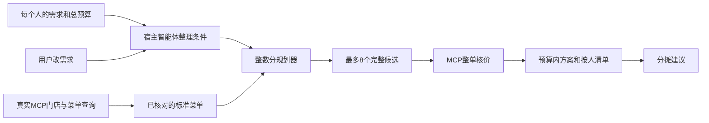

# 麦桌搭子 · mcd-tablemate

**一桌人的口味，一份算清楚的点餐清单。**

面向办公室午餐、宿舍聚餐、朋友一起吃饭的多人点餐 Skill。每个人报自己的需求和口味，麦桌搭子协调总预算、完整套餐与人员分配，给出能逐项核对的方案。有人临时改成咖啡，就重新规划这一桌。

> 本项目是独立参赛作品，非麦当劳官方产品。浏览器演示使用明确标记的模拟菜单；Skill与CLI已完成真实门店查询、整单核价及改单重算。[查看真实验收记录](artifacts/live-verification.md)。

## 三句话就能开始

```text
三个人，预算80元，到店取餐。
小林不吃牛肉和辣，偏好鸡肉；小陈必须有咖啡；小周要主食、饮料和配餐。
帮我们列出每个人吃什么，并算整单价格。
```

之后可以继续说：“小林也想喝咖啡，其他人的要求保持，重新搭配。”

## 解决什么问题

| 常见点餐过程 | 麦桌搭子提供的结果 |
|---|---|
| 聊天里反复问“你吃什么” | 每人独立记录主食、饮料、配餐和口味条件 |
| 把套餐当散件分配，漏算可乐或薯条 | 完整套餐归属到人，附带餐品全部展示与计数 |
| 只知道整单多少钱，不知道谁拿什么 | 按人清单 + 实际购买数量 + 分摊建议 |
| 有人改口味后沿用旧价格 | 旧方案标记过期，重新规划并重新核价 |
| 估算便宜但结算超预算 | 真实使用时逐候选调用 `calculate-price` 核验整单实付 |

第一版支持 2–6 人，硬排除条件与必须餐品不能被自动放松；软偏好可以取舍。提供“照顾偏好”和“节省预算”两种策略。搜索有固定上限，推荐的是本次查询范围内的可行方案，不承诺全局最低价。第一版完整套餐归一个人，不拆分家庭套餐跨人共享。

## 一分钟运行模拟演示

需要 **Python 3.10 或更新版本**，无第三方运行依赖。下载或克隆项目，在项目目录打开终端：

```sh
python -m maimai_team serve
```

浏览器访问 <http://127.0.0.1:8765/>。Windows 也可以双击 `start-demo.cmd`。关闭终端里的服务即可退出；页面与服务只在本机运行。

交互操作：设置各人需求 → 输入预算 → 生成两个方案 → 修改某个人的咖啡要求 → 旧方案失效 → 重算 → 复制清单。所有“模拟”门店、餐品和价格均为原创测试数据，不能作为实际购买依据。UI不接收Token、不存储人员信息、不创建订单。

不用浏览器也能运行：

```sh
python -m maimai_team demo
python -m maimai_team plan --catalog examples/demo_catalog.json --request examples/demo_request.json --out artifacts/my-demo.json
python -m maimai_team report --input artifacts/my-demo.json --out artifacts/my-demo.md
```

默认示例的一份估算清单是：小林鸡肉堡和可乐23元，小陈辣鸡肉堡和美式24元，小周牛肉套餐26元，整桌73元、预算余量7元。**这些数字仅为模拟演示。**

## 安装为 Skill 并连接真实 MCP

项目根目录本身就是 Skill：`SKILL.md` 配合 `scripts/`、`references/` 与 `maimai_team/`。将整个项目复制到所用客户端支持的技能目录，文件夹名设为 `mcd-tablemate`；不要只复制 SKILL.md。客户端需支持运行 Python 和麦当劳远程 MCP。也可直接在项目目录让智能体读取 SKILL.md 执行。

1. 到 [麦当劳 MCP 平台](https://open.mcd.cn/mcp) 登录并申请自己的 Token。
2. 使用 `mcp-config.example.json` 中的官方地址，在客户端的凭证或环境变量功能中配置 Token；环境变量占位符的展开方式以客户端支持情况为准。
3. 让宿主智能体读取 SKILL.md，先确认门店和就餐方式，查询真实菜单、套餐组成与优惠券。
4. 生成候选后用 MCP 实际核价；只输出核价成功且预算内的方案。

完整操作见 [真实接入流程](references/live-workflow.md)。标准库客户端也支持本机 `.env`：复制 `.env.example` 后填写 `MCD_MCP_TOKEN`，运行 `python -m maimai_team discover`。原始工具响应和临时需求写入被 Git 忽略的 `.private/`。

MCP调用参数由实际工具 schema 确定，本项目不会猜商品字段、门店编码或价格单位。不含默认凭证、公共账号或替他人登录的功能。真实核价失败时不会将估算价作为成功价格。

真实响应整理还可以用 `prepare-live` 自动保留套餐轮次、实际已选数量和特制参数。已核对的组件类别与标签由宿主提供，脚本不会猜过敏原或把未知餐品默认为符合排除条件。见[官方响应整理](references/live-workflow.md#官方响应整理)。

## 一次真实改单

2026-10-13，在公开门店到店取餐场景中：三人预算80元，成员A选择鸡肉主食和牛奶，成员B必须有咖啡，成员C需要主食、饮品与配餐。首轮推荐整单实付 **46.00元**；成员A把牛奶改成咖啡，重新规划核价后为 **44.50元**。两轮均核验8个候选，没有创建订单。

首轮菜单估算仅28.00元，接口结算为46.00元；因此本项目用真实整单核价控制预算，促销展示价只用于候选搜索。这是一次带特定门店、时间和账号条件的验收示例，不能承诺其他人的结算价格。

## 架构



自然语言理解使用宿主智能体，核心数量和预算运算是可复现的 Python 代码。分摊按每人完整餐品估算成本比例分配整单实付（含费用），用最大余数法处理分的尾差，合计严格等于整单核验金额；这是一种协商规则，不是每人的实际优惠归属或单品实时价。

## 验证

```sh
python -m unittest discover -s tests -v
node --check web/app.js
python -m maimai_team doctor
```

56项测试覆盖口味和咖啡要求、改单、套餐额外组成、多人数量守恒、共享数量上限、预算不足、分摊合计、核价失败、真实响应结构适配、JSON/SSE协议、凭证错误和写操作阻断。协议测试用本机模拟服务；[真实麦当劳联调](artifacts/live-verification.md)另有验收记录。

## 目标用户和当前边界

适合想减少点餐沟通、统一预算并明确餐品归属的 2–6 人小组。使用某一个账号和门店查询到的菜单/券，不合并多人账号的优惠券。用户必须确认门店和就餐方式；供应变化时重新查询与核价。不提供过敏原安全保证或医疗营养建议，不创建订单或付款。

## 参赛与来源

- [官方活动入口](https://github.com/M-China/mcd-developer-innovation-challenge)
- [MCP集成说明](MCP_INTEGRATION.md)
- [官方原文参赛声明](CONTEST_DECLARATION.md)
- [来源说明](NOTICE.md)

本项目原创代码以 MIT 许可发布。麦当劳服务、数据与官方文档按其自身条款使用；MIT许可不授予麦当劳商标或服务权限。当前由 Codex 开发，未声明使用 WorkBuddy 或领取其开发专项奖励。

English: A small-group meal coordination Skill that keeps each person's requirements explicit, allocates complete meal bundles, verifies whole-cart prices through McDonald's MCP, and replans when someone changes their mind. The included browser demo uses synthetic data.
